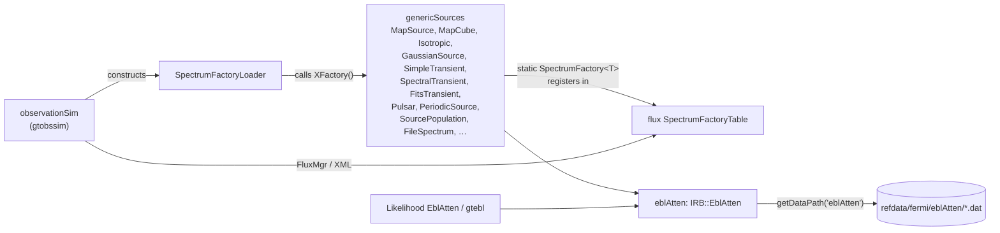

# celestialSources Architecture

**celestialSources** is a *container* package. Its top-level library holds
one class, `SpectrumFactoryLoader`, which registers the astrophysical source
classes with `flux`'s spectrum registry. The real code lives in
sub-packages, each with its own include directory, and only some of them
are built:

| Sub-package | Built? | Library | Reached by |
|-------------|--------|---------|------------|
| `genericSources` | **yes** | `genericSources` (static) | `gtobssim`, through `SpectrumFactoryLoader` |
| `eblAtten` | **yes** | `eblAtten` (static) | `genericSources` transients and populations; `Likelihood` (`EblAtten` spectral function, `gtebl`) |
| `microQuasar` | yes, but unreachable | `microQuasar` (static) | Nothing links it, and its factory call is commented out in the loader |
| `EarthPhenom` | only with `FERMI_BUILD_ROOT=ON` (ROOT) | `EarthPhenom` (static) | Not linked into `celestialSources` even then |
| `GRB`, `GRBobs`, `GRBtemplate`, `Pulsar`, `SpectObj`, `pySources` | **no** (commented out even under ROOT) | — | — |
| `DarkMatter` | **no** (no CMake at all) | — | — |

About 8k of the package's ~30k lines are compiled in a default build
(`eblAtten` ~0.8k, `genericSources` ~5.7k without the ROOT-only `TF1*`
files, `microQuasar` ~0.8k, the loader and headers). The rest is described
in [unbuilt-subpackages.md](unbuilt-subpackages.md).

The Doxygen mainpage (`src/mainpage.h`) and `doc/release.notes` (last entry
2012) predate the CMake build and still describe GRB/Pulsar simulation as
available. They are not.

## Purpose and scope

**Does:**
- Provide `flux` `Spectrum` subclasses for `gtobssim`: FITS map and map-cube
  diffuse sources, isotropic and radial/Gaussian extended sources, point
  sources with file-defined or Gaussian spectra, simple and template
  transients (including FITS light curves and EBL-attenuated spectra),
  periodic and template pulsars, and populations of point sources read
  from a file. See [genericSources.md](genericSources.md).
- Compute EBL optical depth τ(E, z) for 20 published models, from ASCII
  tables or analytic fits (`IRB::EblAtten`). See [eblAtten.md](eblAtten.md).
- Make those classes available by name to `flux::FluxMgr`
  (`SpectrumFactoryLoader`).

**Does not:**
- Parse XML or schedule events across sources. `flux` does that.
- Apply IRFs or write FITS. `observationSim` does that.
- Fit anything. `Likelihood` wraps `eblAtten` as a spectral-model
  multiplier; the fitting is there.
- Simulate GRBs or physical pulsar models in the shipped tools (the code
  exists but is not built).

## Position in the system

| Direction | Package | Why |
|-----------|---------|-----|
| Depends on | `flux` | Every source derives from `Spectrum` and registers through `SpectrumFactory<T>`; `EventSource::totalArea()` sets event rates; `Spectrum::startTime()` anchors transient times. Linked PUBLIC by `genericSources`. |
| Depends on | `astro` | `SkyDir` (coordinate conversion; most sources return (l, b)), `GPS` in tests. |
| Depends on | `facilities` | `Util::expandEnvVar` (every file name in `params`), `Util::stringTokenize`/`keyValueTokenize`, `commonUtilities::getDataPath("eblAtten")`. |
| Depends on | `st_facilities` | `Util::readLines` in `eblAtten`'s `AsciiTableModel` (linked PUBLIC by `eblAtten`). |
| Depends on | `tip` | `FitsTransient` and `SpectralTransient` read light curves and spectra (PRIVATE link from `genericSources`). |
| Depends on | cfitsio | `genericSources/src/FitsImage.cxx` and the public header `genericSources/MapCube.h` include `fitsio.h` directly. |
| Depends on | CLHEP | Random draws (`RandFlat`, `RandPoisson`, `RandGauss`), vectors and rotations. |
| Depends on (ROOT builds only) | ROOT | `EarthPhenom`, `TF1Spectrum`/`TF1Map`, `TRandom4`; see [unbuilt-subpackages.md](unbuilt-subpackages.md). |
| Used by | `observationSim` | `celestialSources/SpectrumFactoryLoader.h`: `gtobssim` and `test_observationSim` construct a `SpectrumFactoryLoader` before creating any `FluxMgr` source. They link the `celestialSources` library. |
| Used by | `Likelihood` | `eblAtten/EblAtten.h` (`IRB::EblAtten`, `IRB::EblModel`) in `Likelihood::EblAtten` (spectral function) and `gtebl`. Likelihood links only `eblAtten`, not the container library. Through `pyLikelihood`, the `EblAtten` function is also reachable from Python. |

**CMake structure.** `celestialSources` links `genericSources` and
`eblAtten` PRIVATE, and `genericSources` links `celestialSources` PUBLIC
(for `celestialSources/ConstParMap.h`). CMake tolerates this cycle only
because all three are static. `origin/Issue17` has an unmerged commit
("Remove cyclic dependency between genericSources and celestialSources").

The front matter and `docs/architecture/dependency-layers.md` agree on the
dependency list (`astro, facilities, flux, st_facilities, tip`).

## Key abstractions



| Type | Header | Role |
|------|--------|------|
| `SpectrumFactoryLoader` | `celestialSources/SpectrumFactoryLoader.h` | Its constructor calls each `XFactory()` function. Each function holds a function-local `static SpectrumFactory<X>`, so the first call registers `X` in `flux`'s `SpectrumFactoryTable`. The calls are also what makes the linker pull each source's object file out of the static `genericSources` library. `names()` lists what was loaded. |
| `ConstParMap` | `celestialSources/ConstParMap.h` | `key=value` parser for `params` strings. `operator[]`/`value()` **throw** if the key is missing (callers wrap optional keys in `try`). The constructor throws if a `flux` key is negative. |
| `TRandom4` | `celestialSources/TRandom4.h` | ROOT `TRandom` backed by CLHEP engines, so ROOT sampling follows the CLHEP seed. ROOT builds only. |
| Source classes | `genericSources/*.h` | See [genericSources.md](genericSources.md). |
| `IRB::EblAtten` | `eblAtten/EblAtten.h` | Function object `τ(E[MeV], z)` for a chosen `IRB::EblModel`. See [eblAtten.md](eblAtten.md). |

## Data flow and control flow

In `gtobssim` (see `src/observationSim/doc/architecture/`):

```
obsSim::run
  SpectrumFactoryLoader foo;          // registers the 16 genericSources classes
  Simulator(...)
    FluxMgr(xmlFiles)                 // flux parses XML
    FluxMgr::source(name)
      FluxSource: SpectrumFactoryTable::instantiate("MapSource", params)
        → new MapSource(params)       // parses params, expands $(VARS), reads FITS / ASCII,
                                      // transients pre-draw all event times here
  event loop: FluxSource::event(t)
      MapSource::interval(t)          // -ln(1-u) / (flux · EventSource::totalArea())
      MapSource::energy(t)            // MeV
      MapSource::dir(E)               // (l, b) → flux SourceDirection with frame="galaxy"
```

Every `genericSources` class except `FileSpectrum` computes its own
`interval()` from its `flux` parameter and `EventSource::totalArea()`, so
`flux`'s Poisson fallback and the `<source flux>` attribute are not used.
`FileSpectrum` returns −1 and lets `FluxSource` draw a Poisson interval from
its `flux()` × solid angle (1) × area. The `flux` parameter in `params` is a
total photon flux in **photons/m²/s** (integrated over energy and over the
source's sky region), not per steradian.

In `Likelihood`, `EblAtten` multiplies another spectral function by
`exp(-tau_norm · τ(E, z))` with `IRB::EblAtten(model)`; `gtebl` writes
τ tables.

## Public interfaces

### C++ API

Installed headers: `include/celestialSources/` (`SpectrumFactoryLoader.h`,
`ConstParMap.h`, `TRandom4.h`), `include/genericSources/`,
`include/eblAtten/`, `include/microQuasar/`. Only
`SpectrumFactoryLoader.h` and `eblAtten/EblAtten.h` are used outside the
package.

```cpp
#include "celestialSources/SpectrumFactoryLoader.h"
SpectrumFactoryLoader loader;          // do this once, before FluxMgr::source()
// loader.names() → {"FitsTransient", "GaussianSource", ..., "RadialSource"}

#include "eblAtten/EblAtten.h"
IRB::EblAtten tau(IRB::Dominguez11);
double attenuation = std::exp(-tau(1e5 /* MeV */, 0.5 /* z */));
```

### Applications

None. Test drivers are installed to `bin/`: `test_celestialSources`,
`test_genericSources`, `test_eblAtten`, `test_microQuasar`.

### Python

None. `pySources/` (two old scripts) is not built or installed.

### Environment variables

| Variable | Used where | Notes |
|----------|-----------|-------|
| `GENERICSOURCESDATAPATH` | `$(GENERICSOURCESDATAPATH)` in `genericSources/xml/source_library.xml` params, expanded by each source class | Set **only** by conda activation (`recipe/activate.sh`) to `$CONDA_PREFIX/share/fermitools/data/genericSources`, matching where CMake installs `genericSources/data/`. `setupEnvironment()` does not set it, because `genericSources` is not in `FERMI_COMPONENTS`. See "Runtime environment" in ScienceTools' `docs/architecture/README.md`. |
| `EXTFILESSYS` | `genericSources/xml/source_library.xml` (`galdiffuse/EGRET_diffuse_gal.fits`) | That file is not shipped in `refdata/fermi`. |
| `GRBTEMPLATEDATAPATH`, `PULSARDATA`, `PULSAR_*`, `SKYMODEL_DIR`, `GRBOBS_*`, `DISABLE_SAA` | Unbuilt `GRBtemplate`, `Pulsar`, `GRBobs` | Nothing sets them; the code reading them is not compiled. |

`eblAtten` finds its tables with `getDataPath("eblAtten")` =
`$FERMI_INST_DIR/refdata/fermi/eblAtten`.

### Data and install destinations

| Source dir | Installed to | Found by |
|------------|--------------|----------|
| `eblAtten/data/` (EBL τ tables, model READMEs) | `${FERMI_INSTALL_REFDATADIR}/eblAtten` = `share/fermitools/refdata/fermi/eblAtten` | `getDataPath("eblAtten")` |
| `genericSources/data/` (light-curve templates, test images/cubes, spectra, `sourcePop.dat`) | `${FERMI_INSTALL_DATADIR}/genericSources` = `share/fermitools/data/genericSources` | **only** `$GENERICSOURCESDATAPATH`; `getDataPath("genericSources")` would look in `refdata/fermi/genericSources` and miss it |
| `genericSources/xml/source_library.xml` | `${FERMI_INSTALL_XMLDIR}/genericSources` | `getXmlPath("genericSources")` (test only) |
| `microQuasar/xml/mq.xml` | `${FERMI_INSTALL_XMLDIR}/microQuasar` | `test_microQuasar` |
| `EarthPhenom/xml`, all `GRB*`, `Pulsar`, `SpectObj`, `DarkMatter` data/xml | not installed | — |

## Build and test

- **CMake targets:** `celestialSources` (STATIC, `src/SpectrumFactoryLoader.cxx`
  only), `eblAtten`, `genericSources`, `microQuasar` (all STATIC), and the
  executables `test_celestialSources`, `test_eblAtten`,
  `test_genericSources`, `test_microQuasar`. With `FERMI_BUILD_ROOT=ON`,
  also `EarthPhenom` and `test_EarthPhenom` (see the gotcha: that
  configuration is broken).
- **`BUILD_WITHOUT_ROOT`** is defined PRIVATE on `celestialSources` when
  ROOT is off. `genericSources` and its test get it anyway from `tip`, which
  defines it PUBLIC unconditionally, so the `TF1*` sources are compiled out
  of `test_genericSources` in every configuration.
- **`TRAP_FPE`** is defined globally (non-Apple), so `test_eblAtten` and
  `test_genericSources` enable floating-point exceptions.
- **No test is registered with CTest** (there are no `add_test` calls).
  - `test_celestialSources` constructs the loader and prints the
    registered names. No assertions.
  - `test_eblAtten` prints τ for all 20 models on a grid of energies
    (1 GeV to 500 GeV) and redshifts (0 to 3). No assertions; it fails only
    by throwing (e.g. a missing table). Needs `FERMI_INST_DIR` and an
    install.
  - `test_genericSources` runs a `dgaus8` check, loads the **installed**
    `xml/fermi/genericSources/source_library.xml`, builds about 20 named
    sources, generates events (default 2000, or `argv[1]`) into
    `test_data.dat` in the **current directory**, then runs
    `Util_tests()` (`src/test/TestUtil.h`). Needs `FERMI_INST_DIR` and
    `GENERICSOURCESDATAPATH`. It also asks for `filespectrummap_test`,
    whose XML points at `$(EXTFILESSYS)/galdiffuse/EGRET_diffuse_gal.fits`,
    a file that is not installed, so it is expected to stop there with an
    exception (from reading the code; not checked at runtime).
  - `test_microQuasar` runs the `mq.xml` source through `FluxMgr`.
- **ST-unit-test:** the default run of ScienceTools'
  `recipe/tests/ST-unit-test` (`unitTestsWithoutRoot`) runs all four test
  programs and passes on their exit status. The only output check,
  `check_test_genericSources_output`, verifies that `test_data.dat`
  **exists**; it computes `share/fermitools/data/genericSources/outref`
  but never compares against it, and no `genericSources` reference data
  exists anywhere. `fermitools-data` has `outrefFiles/GRBobs` and
  `outrefFiles/GRBtemplate` (installed by the `fermitools-data` package),
  but those sub-packages are not built and their tests and
  `check_test_GRB*_output` entries are commented out even in the ROOT list.
  See "Testing" in ScienceTools' `docs/architecture/README.md`.
- **Legacy files:** `SConscript`, `*Lib.py`, `cmt/` directories,
  `azure-pipelines.yml`.

## Invariants and gotchas

**What is actually available in `gtobssim`**
- Exactly the classes the default-build loader registers: `FitsTransient`,
  `GaussianSource`, `GaussianSpectrum`, `Isotropic`,
  `IsotropicFileSpectrum`, `MapSource`, `MapCube`, `PeriodicSource`,
  `Pulsar`, `SimpleTransient`, `SourcePopulation`, `SpectralTransient`,
  `TransientTemplate`, `FileSpectrum`, `FileSpectrumMap`, `RadialSource`,
  plus `flux`'s built-ins. `GRBmanager`, `GRBobsmanager`,
  `GRBtemplateManager`, `PulsarSpectrum`, `microQuasar`, `TF1Spectrum`,
  `TF1Map`, `EarthPhenomLimb`, `EarthPhenomInner` and `EventList` appear
  in old XML and docs but are **unknown names** in a default build; using
  one makes `FluxSource` throw "Unknown Spectrum".
- `genericSources/xml/source_library.xml` itself contains `TF1Spectrum`,
  `TF1Map` and `EventList` entries. They fail only if requested.

**`FERMI_BUILD_ROOT=ON` is broken (from reading the CMake; not built)**
- `target_sources(celestialSources src/TRandom4.cxx)` has no
  `PRIVATE`/`PUBLIC` keyword, which CMake rejects.
- Even if fixed, the loader would reference `GRBmanagerFactory`,
  `GRBobsmanagerFactory`, `GRBtemplateManagerFactory`, `TF1SpectrumFactory`,
  `TF1MapFactory` and the `EarthPhenom` factories. Their sub-directories are
  commented out, the `TF1*` sources are not in `genericSources`' source
  list, and `EarthPhenom` is not linked into `celestialSources`, so the
  link would fail.
- `docs/architecture/dependency-layers.md` lists ROOT as an optional
  dependency of `celestialSources`; in practice only the default (no-ROOT)
  configuration works.

**Registration**
- The loader must run **before** the first `FluxMgr::source()` call;
  otherwise every `SpectrumClass` name from this package is unknown.
- A class is reachable only if its `XFactory()` function is called from
  the loader. Adding a class to `genericSources` without adding the call
  leaves it out of `gtobssim` silently (the linker drops the object file).

**Parameters**
- Many classes accept two `params` syntaxes. The choice is made by whether
  the string contains `=` anywhere. Positional parsing uses `atof`, so a
  typo becomes 0 rather than an error.
- `$(VAR)` in file names is expanded by each class with
  `facilities::Util::expandEnvVar`. If the variable is unset it throws
  `facilities::Untranslatable`, whose `what()` is just the bare variable
  name (for example `GENERICSOURCESDATAPATH`), with no other context.
- `eblModel` is an **integer index** into `IRB::EblModel`. The enum order
  is part of the XML and Likelihood model interface, so never reorder it;
  append new models.

**Global state**
- `flux`'s `EventSource::totalArea()` and `Spectrum::startTime()` are
  process-wide. Most transients draw their event times in the
  constructor (`SpectralTransient` lazily, per light-curve interval) using
  the area at that moment. Transient `tstart`/`tstop` and pulsar
  epochs are measured from `Spectrum::startTime()`, which `gtobssim` sets
  from `startdate` (MET of that date), **not** from `tstart`.
- `SourcePopulation` keeps its EBL model in a **static**
  `PointSource::s_tau`. With two populations using different `eblModel`s
  the last one constructed wins for both, and destroying that population
  leaves the other with a dangling pointer (from reading the code; not
  checked at runtime).

**Units**
- `IRB::EblAtten::operator()` takes energy in **MeV** (it divides by 1000).
  The comment in `EblAtten.h` says GeV; it is wrong.
- Source directions from `dir()` are **(l, b) in degrees** for all
  `genericSources` classes. Use `<use_spectrum frame="galaxy"/>`.

## Extension points

- **New source type:** add `genericSources/genericSources/X.h` and
  `genericSources/src/X.cxx` deriving from `Spectrum` (global namespace),
  with `X(const std::string& params)`. Define
  `ISpectrumFactory& XFactory() { static SpectrumFactory<X> f; return f; }`.
  Add the `.cxx` to `genericSources/CMakeLists.txt`, declare and call
  `XFactory()` in `src/SpectrumFactoryLoader.cxx` (and in
  `genericSources/src/test/test.cxx` `load_sources`), and add an example
  to `genericSources/xml/source_library.xml`. Details in
  [genericSources.md](genericSources.md#adding-a-source-class).
- **New EBL model:** append to `IRB::EblModel`, add a `calcX` in
  `IRB_routines.cxx` (usually an `AsciiTableModel` on a new
  `data/opdep_*.dat`), a `case` in `EblAtten::operator()`, a name in
  `s_model_Ids`, and a line in `data/README_EBLmodels.txt`. Update
  `Likelihood`'s documentation of `ebl_model`. See
  [eblAtten.md](eblAtten.md#adding-a-model).
- **Reviving a ROOT sub-package:** see
  [unbuilt-subpackages.md](unbuilt-subpackages.md).

Before merging changes, run `test_genericSources`, `test_eblAtten`,
`test_observationSim`, and (for `eblAtten`) the Likelihood tests.

## Further reading

- [genericSources.md](genericSources.md): every source class, its
  parameters and behaviour.
- [eblAtten.md](eblAtten.md): EBL models, table format, interpolation and
  range behaviour.
- [unbuilt-subpackages.md](unbuilt-subpackages.md): GRB, GRBobs,
  GRBtemplate, Pulsar, SpectObj, EarthPhenom, microQuasar, DarkMatter,
  pySources.
- `src/flux/doc/architecture/`: the registry, XML format and event loop
  these classes plug into (including current `flux` regressions that
  affect `gtobssim`).
- `src/observationSim/doc/architecture/`: how `gtobssim` uses the loader.
- `genericSources/src/mainpage.h`: older per-class parameter notes
  (mostly accurate for the positional syntax; some data paths are stale).
- `eblAtten/data/README_EBLmodels.txt`: model references and IDs.
